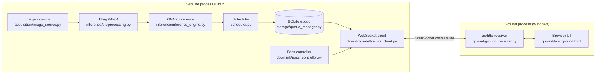
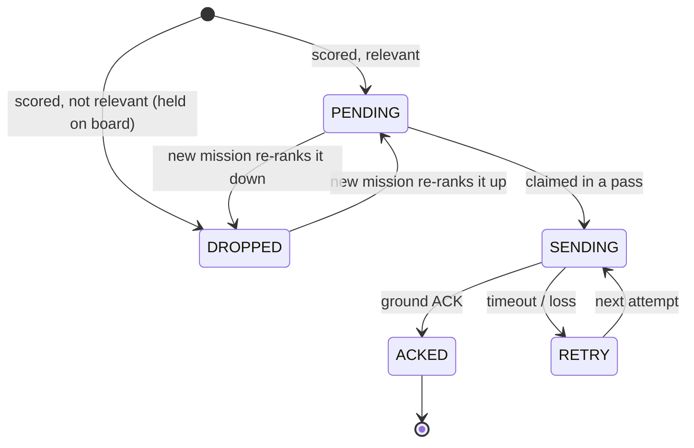
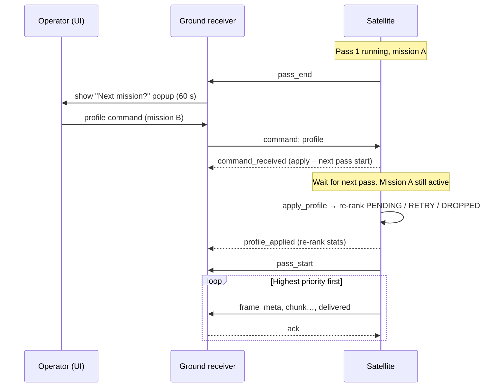

# Orbit Triage: Project Documentation

**On-board AI triage for satellite imagery, with a simulated satellite ↔ ground-station link**

| | |
|---|---|
| **Project** | Orbit Triage (repository: `Hack_Orbital`) |
| **Repository** | https://github.com/Yuvraj2412/Hack_Orbital |
| **Team** | `[Add team name]` |
| **Members** | `[Add names and roles]` |
| **Event / Problem statement** | `[Add event name and problem-statement title or ID]` |
| **Version** | Synced satellite ↔ ground release (31 Oct 2026) |

---

## Contents

1. [Executive summary](#1-executive-summary)
2. [Problem](#2-problem)
3. [Solution overview](#3-solution-overview)
4. [System architecture](#4-system-architecture)
5. [Machine-learning pipeline](#5-machine-learning-pipeline)
6. [Satellite software](#6-satellite-software)
7. [Ground station](#7-ground-station)
8. [Communication protocol](#8-communication-protocol)
9. [Mission lifecycle](#9-mission-lifecycle)
10. [Setup and operation](#10-setup-and-operation)
11. [Testing and validation](#11-testing-and-validation)
12. [Results](#12-results)
13. [Limitations and honest claims](#13-limitations-and-honest-claims)
14. [Future work](#14-future-work)
15. [Appendices](#15-appendices)

---

## 1. Executive summary

Earth-observation satellites collect far more imagery than they can send down. A ground-station pass lasts minutes and the radio link is slow, so what is sent first matters. A simple first-in-first-out (FIFO) queue spends scarce bandwidth on cloudy or irrelevant frames.

**Orbit Triage** moves the decision onto the satellite. A 1.27 MB int8 vision model scores every 64×64 image tile for seven classes (Forest, Cropland, Urban, Water, Cloud, CloudShadow, Ship). A scheduler combines those scores with an operator-defined **mission** to compute a relevance value and a priority. During each pass the most relevant tiles are transmitted first. Tiles that are not relevant now are **held on board, never deleted**, so a later mission can bring them back.

The project delivers three things:

1. **A compressed ML model** trained on public datasets and quantised to int8 with quantisation-aware training (QAT).
2. **A working satellite-side pipeline**: ingestion, tiling, inference, a persistent SQLite queue, a mission-aware scheduler, a pass emulator and a reliable downlink client.
3. **A ground station** with a live browser UI that shows only what actually arrived, and lets an operator change the mission between passes.

---

## 2. Problem

| Constraint | Consequence |
|---|---|
| Short visibility windows (passes) | Only a small amount of data can be sent per pass |
| Low, variable link rate with packet loss | Transmission must be chunked, acknowledged and retried |
| Much of the imagery is clouds or irrelevant to the current task | FIFO wastes the pass |
| Tiny on-board compute and memory (4.2 MB model budget used in this project) | The model must be small and quantised |
| Mission needs change over time | Held data must be re-prioritised without re-capturing |

**Goal:** maximise the share of *mission-relevant* tiles that reach the ground in each pass, within the model-size budget, while keeping all captured data available for future missions.

---

## 3. Solution overview

```
 capture ─► tile (64×64) ─► score on board (int8 model) ─► store with raw scores
                                                    │
              mission profile (interest classes, picky, band)
                                                    ▼
                          relevance → priority (1 MISSION · 2 AMBIGUOUS · 3 HELD)
                                                    │
                       pass window opens ─► send highest priority first
                                                    │
                      ground ACKs ─► UI shows only received tiles
                                                    │
                  next mission chosen ─► re-rank held tiles ─► next pass
```

### Design principles

- **No dropping.** Every tile is stored with its full score vector. "Dropped" in the database means *held on board*; the file stays on disk.
- **Satellite autonomy.** The satellite never blocks on the operator. No new mission means the previous one continues.
- **Ground truth on the ground = what arrived.** The UI renders only completed, acknowledged deliveries.
- **No label leakage.** Tile IDs sent to the ground are neutral (`IMG<hash>_<index>`). Original dataset names stay in satellite-side metadata for scoring and FIFO comparison.
- **Honest simulation.** Link, sensor and pass timing are emulated and documented as such.

---

## 4. System architecture



### Components

| Component | File | Responsibility |
|---|---|---|
| Entry point | `satellite/satellite_main.py` | Parses flags, wires the components, runs the async loop |
| Ingestor | `satellite/acquisition/image_source.py` | Watches `storage/incoming/`, waits for files to be stable, de-duplicates by content fingerprint, records capture time and inference timing |
| Tiling and preprocessing | `satellite/inference/preprocessing.py` | Cuts images into 64×64 tiles, outputs float32 `(N,3,64,64)` in [0,1] |
| Inference engine | `satellite/inference/inference_engine.py` | Runs the ONNX model (CUDA if available, else CPU), returns 7 scores per tile |
| Scheduler | `satellite/scheduler.py` | Relevance, priority, `apply_profile`, neutral tile IDs |
| Queue | `satellite/storage/queue_manager.py` | SQLite store with status, priority, relevance, scores, attempts; atomic claim; `reprioritize`; `reset_queue` |
| Pass controller | `satellite/downlink/pass_controller.py` | Emulates passes: start, length, period, elevation-shaped link rate and loss |
| WebSocket client | `satellite/downlink/satellite_ws_client.py` | Chunked transmission, ACK handling, retries, profile commands, recycle |
| Feeder | `satellite/feeder.py` | Copies dataset images into `incoming/` at a set interval so the queue grows during a demo |
| FIFO comparison | `satellite/fifo_vs_triage.py` | Real-data comparison of triage vs FIFO for one pass |
| Ground receiver | `ground/ground_receiver.py` | aiohttp server, satellite and UI WebSockets, saves received images |
| Ground UI | `ground/live_ground.html` | Live inbox, mission controls, timed mission popup |

---

## 5. Machine-learning pipeline

The pipeline lives in `Flow_code/`, organised in four phases.

```
Phase A  Collect and prepare data  →  Phase C  Train FP32 model  →  Phase B  Shrink to int8  →  Phase D  Final evaluation
```

> The folders are named A → B → C → D in the repo, but the working order is **A → C → B → D**: the FP32 model from Phase C is the input to the int8 conversion in Phase B.

### 5.1 Phase A: data collection and preparation

**Goal:** one consistent set of 64×64 RGB tiles with seven multi-label targets.

| Script | Purpose |
|---|---|
| `cloudsen_slicing.py` | Reads CloudSEN12 L1C scenes (via `tacoreader`), builds RGB from bands 4, 3, 2 (clip at 3000, scale to 8-bit), slices into 64×64 patches, labels cloud and shadow from the mask using a 5 %-of-pixels threshold |
| `hrsid_slicing.py` | Slices HRSID SAR images with COCO annotations into 64×64 tiles; **Ship** if a ship's centre is inside the tile or ≥ 50 % of its box is inside; **NoShip** if no overlap; ambiguous slivers are discarded |
| `manifest_v2.py` | Builds `manifest.csv` with class mapping and a 70 / 15 / 15 split (train / calibration / test) |
| `cache_builder.py` | Packs tiles into `train.npz`, `cal.npz`, `test.npz` with arrays `X` (images), `Y` (labels), `M` (label mask), `group`, `source` |
| `colour_check.py` | Sanity check: per-group colour statistics and a montage, to confirm sources are not trivially separable by colour |

**Class mapping**

| Our class | Source | Origin |
|---|---|---|
| Forest | EuroSAT | `Forest` |
| Cropland | EuroSAT | `AnnualCrop`, `PermanentCrop`, `Pasture` |
| Urban | EuroSAT | `Residential`, `Industrial`, `Highway` |
| Water | EuroSAT | `River`, `SeaLake` |
| Cloud, CloudShadow | CloudSEN12 | cloud and cloud-shadow masks (high-quality labels kept) |
| Ship | HRSID | ship / no-ship tiles |

`HerbaceousVegetation` is left out of EuroSAT. EuroSAT tiles are treated as cloud-free (Cloud = 0, CloudShadow = 0).

**Masked multi-label targets.** `Y` holds a label per class and `M` marks whether that label is *known* for that tile. A Ship tile from HRSID, for example, has no valid "Forest" label, so that entry is masked rather than set to zero. This avoids teaching the model false negatives.

**Filtering and balancing**

- Optical sources (EuroSAT, CloudSEN12): tiles with more than 0.5 % near-black pixels (all channels ≤ 6) are dropped as no-data.
- Train-split caps per group: Cloud 8,000 · CloudShadow 8,000 · CloudBoth 4,000 · Clear 8,000 · Ship 15,000 · NoShip 15,000. Other groups keep every tile.
- Calibration and test caps per source: EuroSAT all, CloudSEN12 20,000, HRSID 40,000.
- Fixed seed (`SEED = 0`) throughout.

### 5.2 Phase C: FP32 training

| Item | Setting |
|---|---|
| Backbone | MobileNetV3-Small, ImageNet weights (when available) |
| Head | One linear layer, 576 → 7 (replaces the 1000-class MLP) |
| Input | 64×64 tile; bilinear resize to 96×96 and ImageNet normalisation happen **inside** the model |
| Loss | Masked binary cross-entropy, averaged per class, then over classes that have labels |
| Optimiser | AdamW, lr 2e-3, weight decay 1e-4, OneCycleLR |
| Batch / epochs | 256 / up to 20, early stop after 4 epochs without macro-AP gain on the calibration split |
| Sampling | Class-balanced, weight ∝ 1 / √(group size) |
| Augmentation | Random flips, 90° rotations, ±15 % brightness and contrast jitter |
| Precision | Mixed precision (AMP) on GPU |
| Metric | Average precision (AP) and best-threshold F1 per class |

Each class is scored **only on the source where its labels are real** (Forest/Cropland/Urban/Water on EuroSAT, Cloud/CloudShadow on CloudSEN12, Ship on HRSID). This prevents the cloud-free EuroSAT tiles from inflating the cloud score.

`diagnostics.py` reports AP, best F1 and its threshold, precision-recall curves, and montages of confident mistakes for error analysis.

### 5.3 Phase B: shrinking to int8

| Step | Script | What it does |
|---|---|---|
| Static post-training quantisation | `quantize_onnx.py` | Exports FP32 to ONNX, calibrates on about 400 tiles (40 per group) with MinMax and Percentile methods, keeps the better one, checks the size against the 4.2 MB budget |
| **Quantisation-aware training** | `qat_finetune.py` | FX-graph QAT: 200 calibration batches, then 8 epochs at lr 2e-4 (cosine to 1e-6), observers frozen from epoch 5, same balanced sampling and augmentation |
| Export | `export_qat_onnx.py` | Converts the QAT model to a reference-quantised graph and exports ONNX (opset 13) |
| **Packing** | `pack_qat_onnx.py` | Folds the fake-quantisation nodes into int8 weight constants so the stored graph is compact |
| Verification | `check_onnx_ort.py` | Runs the packed model in ONNX Runtime, checks outputs, and estimates weights + peak activation memory against the 4.2 MB budget |

The **shipped model** is the QAT result after packing: `satellite/model/model_qat_int8_packed.onnx` (**1,272,957 bytes ≈ 1.27 MB**).

### 5.4 Phase D: final evaluation

`evaluate_test.py` loads the held-out `test.npz`, runs the **packed int8 ONNX model** on ONNX Runtime CPU (batch 512), applies a sigmoid, and prints per-class AP, best F1 and macro AP.

```text
Class           | Average Precision (AP) | Max F1 Score
Forest          | ...                    | ...
...
MACRO AP        | ...
```

Results are filled in Section 12.

---

## 6. Satellite software

### 6.1 Processing flow

1. **Ingest.** New files in `storage/incoming/` are picked up after a short stability wait (`--stable-wait`, default 0.1 s). A content fingerprint prevents re-processing the same image.
2. **Tile.** Each image is cut into 64×64 tiles, saved under `storage/tiles/` and described in `storage/metadata/`.
3. **Score.** The ONNX model returns seven sigmoid scores per tile. `predicted_class` is the argmax over all seven.
4. **Rank.** The scheduler computes relevance and priority for the active mission profile.
5. **Store.** The tile, scores, priority and relevance are inserted in the SQLite queue.

### 6.2 Relevance and priority

```
relevance = Σ score(c) for c in interest
            − score(Cloud)        if Cloud ∉ interest
            − score(CloudShadow)  if CloudShadow ∉ interest
```

| Condition | Priority | Name | DB status |
|---|---|---|---|
| `relevance ≥ picky + band` | 1 | MISSION | PENDING |
| `picky − band < relevance < picky + band` | 2 | AMBIGUOUS | PENDING |
| `relevance ≤ picky − band` | 3 | HELD | DROPPED (file kept) |

Defaults `picky = 0.70`, `band = 0.20`. Selectable mission classes are Forest, Cropland, Urban, Water, Cloud and Ship. **CloudShadow is not selectable**, because it is an adverse observation rather than a target, but its score still reduces relevance.

### 6.3 Queue and tile states



- Send order: `priority ASC, relevance DESC, created_at ASC`.
- Claiming a tile and marking it `SENDING` is atomic.
- `reprioritize(fn)` re-ranks every PENDING, RETRY and DROPPED row from its stored `scores_json` in **one transaction**. SENDING and ACKED rows are never touched.
- Older databases are migrated automatically (the `relevance` column is added if missing).

### 6.4 Pass controller (emulated link)

| Parameter | Default | Meaning |
|---|---|---|
| `--first-pass` | 10 s | Delay before the first pass |
| `--pass-period` | 120 s | Start-to-start interval |
| `--pass-length` | 60 s | Duration of each pass |
| `--peak-kbps` | 256 | Peak link rate |

The link rate and packet-loss probability follow an **elevation curve** `sin(π · progress)` across the pass: weakest at the edges, best in the middle. Image data is sent only while a pass is open; the WebSocket stays connected between passes for control traffic.

### 6.5 Downlink client

- Tiles are split into chunks (`--packet-bytes`, default 1024) and paced by the current link rate.
- A lost chunk is retried within the same pass (simulated loss).
- Each frame ends with a `delivered` event and waits for a ground **ACK** (`--ack-timeout`, default 15 s). Without an ACK the tile goes to `RETRY`.
- On reconnect the satellite sends a new `hello` with the same `run_id`, so the ground UI does **not** clear its inbox on a Wi-Fi blip.
- **Timing fields** per frame: `capture_t` (mission-elapsed seconds) and `latency_s` (send time minus capture time). Both are computed on the satellite from a shared monotonic clock, so they stay correct when the two laptops' wall clocks differ.

### 6.6 Recycling for repeat demos

- If tiles are still held after a pass, **no recycle** happens; only re-ranking, and held tiles go in the next pass.
- If the queue is **completely empty** (no PENDING, RETRY or HELD) and a new mission arrives, archived images are copied back into `incoming/`, the queue, tiles and markers are cleared, and tiles are re-queued under the new mission. A new `run_id` makes the ground clear its inbox.
- The operator can also press **Start new cycle (same images again)** at any time. It is refused if a tile is mid-transmission.

### 6.7 FIFO comparison tool

`fifo_vs_triage.py` takes one pass, finds the bytes actually ACKed (sum of `estimated_wire_bytes`), and asks: *with the same byte budget, what would capture-order FIFO have sent?* A tile counts as relevant if it meets the MISSION threshold. The tool uses real tile sizes and real model scores, and the satellite-side original labels as truth.

---

## 7. Ground station

### 7.1 Receiver (`ground_receiver.py`)

| Route | Purpose |
|---|---|
| `GET /` | Serves `live_ground.html` |
| `GET /health` | Liveness check |
| `GET /received/{name}` | Serves a completed received image |
| `GET /static/{name}` | Static assets |
| `WS /ws/satellite` | Satellite connection: events and chunks in, ACKs and commands out |
| `WS /ws/ui` | Browser connection: broadcasts events, forwards operator commands |

Completed images are written to the `received/` directory. Delivered history is capped at 1,000 items and events at 500. Frame metadata with unsafe IDs is rejected.

### 7.2 Browser UI (`live_ground.html`)

- **Connection status** for the ground receiver and the satellite.
- **Mission controls**: selectable class chips, a "How picky" slider, a "Preview window" (band) slider, presets such as Vegetation (Forest + Cropland), and a **Send mission profile** button.
- **Timed mission popup.** When a pass ends, a 60-second *Next mission?* popup appears with the time to the next pass. Choosing a mission applies it at the next pass start. Doing nothing keeps the previous mission. The satellite never waits.
- **Inbox** of received tiles, capped at 1,000, with a header showing per-class counts (for example, "Forest 12 · Cropland 8").
- **Per-card details:** capture time (T+ mm:ss), latency, priority (MISSION or AMBIGUOUS), and top class scores.
- **Held-onboard wording** replaces "dropped" so the interface matches the design (data is kept).
- **Start new cycle** button for repeat demos.
- The power-telemetry card and manual *Open pass* button were removed: passes are automatic, and there is no power sensor.

---

## 8. Communication protocol

All traffic is JSON over one WebSocket (`ws://<GROUND_IP>:8765/ws/satellite`).

### 8.1 Satellite → ground

| Event | Content |
|---|---|
| `hello` | `run_id`, `interest_classes`, active `profile`. Sent on every (re)connect |
| `telemetry` | Pass state, link rate and loss, queue counts, delivered counts |
| `pass_start`, `pass_end` | Pass number and timing |
| `profile_applied` | Applied at pass start, with the re-rank statistics |
| `command_received` | Acknowledges a profile command: *apply = next pass start* |
| `frame_meta` | Neutral `frame_id`, size, relevance, priority name, `capture_t`, `latency_s` |
| `chunk` | One slice of the tile payload |
| `delivered` | Frame complete; asks for an ACK |

### 8.2 Ground → satellite

| Message | Meaning |
|---|---|
| `ack` (`frame_id`, `ok`) | Frame stored on the ground |
| `command: profile` | New mission: interest classes, picky, band. **Stored, applied at the next pass start** |
| `command: new_cycle` | Recycle archived images into a fresh run |
| `command: open_pass` | Manual pass (the button was removed from the UI; passes are automatic) |
| `command: request_full` | Answered with a refusal: only full-resolution tiles are stored |
| `command: fault` | Answered "fault injection not implemented" |

### 8.3 Sequence of one mission change



---

## 9. Mission lifecycle

1. **Start.** Satellite starts with `--interest` classes, `--picky` and `--band`.
2. **Capture and score.** Images arrive (optionally dripped by the feeder). Every tile is scored and queued or held.
3. **Pass.** A pass opens automatically. Highest-priority tiles are sent and ACKed; leftovers stay queued.
4. **Pass ends.** Ground shows the 60-second mission popup.
5. **Next mission (optional).** If chosen, it is stored and applied at the **next pass start**, re-ranking the whole backlog.
6. **Repeat**, or recycle archived images if the queue is empty.

---

## 10. Setup and operation

### 10.1 Requirements

| | Ground | Satellite |
|---|---|---|
| Python | 3.10+ | 3.10+ |
| Packages | `aiohttp ≥ 3.9` | `aiohttp ≥ 3.9`, `numpy ≥ 1.24`, `Pillow ≥ 10.0`, `onnxruntime ≥ 1.17` |
| OS used in the demo | Windows | Linux |

Both run on one machine too (use `127.0.0.1`).

### 10.2 Commands

```bash
# Ground
cd Orbit-Triage-Synced/ground
python -m pip install -r requirements.txt
python ground_receiver.py --host 0.0.0.0 --port 8765
# open http://localhost:8765/

# Satellite (first time)
cd Orbit-Triage-Synced/satellite
python3 -m venv venv && source venv/bin/activate
python -m pip install -r requirements.txt

# Satellite (each run)
python3 satellite_main.py --ground ws://<GROUND_IP>:8765/ws/satellite \
  --interest Forest Cropland Urban Water --cpu \
  --first-pass 10 --pass-period 120 --pass-length 60 --peak-kbps 256 --stable-wait 0.1

# Feeder (second terminal)
python3 feeder.py --source-dir /path/to/dataset --interval 1.0
```

### 10.3 Inspecting the queue

```bash
python3 storage/queue_manager.py --list PENDING
```

### 10.4 Fresh start

Delete `storage/queue.db*`, `storage/tiles/*` and `storage/metadata/*.json`. **Keep `storage/archive/`**, which is the recycle source. To use a new dataset, clear the archive too and feed the new images.

### 10.5 Reproducing the model

1. Place EuroSAT, CloudSEN12 and HRSID under a data root and edit the path variables at the top of the Phase A scripts (they currently point to the authors' machine).
2. Run Phase A scripts in this order: `cloudsen_slicing.py`, `hrsid_slicing.py`, `manifest_v2.py`, `cache_builder.py`, `colour_check.py`.
3. Create a `.env` with `DATA_ROOT` and run `train_baseline.py` (Phase C), optionally `diagnostics.py`.
4. Run Phase B: `quantize_onnx.py` (baseline), `qat_finetune.py`, `export_qat_onnx.py`, `pack_qat_onnx.py`, `check_onnx_ort.py`.
5. Set `ROOT` in `.env` and run `evaluate_test.py` (Phase D).

---

## 11. Testing and validation

| Test | Method | Outcome |
|---|---|---|
| Scheduler and queue unit test | Forest → Water mission change | Water tile moved to PENDING, Forest tile to HELD; order = priority → relevance → capture time |
| Fake-integration test | Real WebSocket client + real ground receiver | `command_received` returned on profile send; `profile_applied` only at pass start; Water tile sent first as MISSION; replay delivered the tile once; `new_cycle` produced a new `run_id` hello |
| Real-model end-to-end test | 6 images, real ONNX model, mission Forest → Vegetation, automatic passes | Pass 1: 3 Forest tiles sent as MISSION (relevance ≈ 0.999, capture ≈ 0.65 s, latency ≈ 5 s), 3 Cropland held. Pass 2: the held Cropland tiles sent (latency ≈ 50 s, since they waited from pass 1). 6/6 ACKed, no duplicates, no Forest tile re-sent |
| Recycle regression | Old behaviour recycled at pass start (6 tiles re-sent) | Final design recycles only when the queue is empty, so pass 2 sent only the held tiles |
| Inbox-wipe regression | Reconnect with same `run_id` | Inbox is no longer cleared on a Wi-Fi blip |

---

## 12. Results

### 12.1 Model

| Metric | Value |
|---|---|
| Shipped file | `model_qat_int8_packed.onnx` |
| File size | **1.27 MB** (1,272,957 bytes) |
| Size budget | 4.2 MB |
| Classes | 7 |

**Per-class accuracy on the held-out test split** (run `Phase D_Final result/evaluate_test.py`; the repository does not include its output, so fill in from your run):

| Class | Evaluated on | Average precision | Max F1 |
|---|---|---|---|
| Forest | EuroSAT | `[fill]` | `[fill]` |
| Cropland | EuroSAT | `[fill]` | `[fill]` |
| Urban | EuroSAT | `[fill]` | `[fill]` |
| Water | EuroSAT | `[fill]` | `[fill]` |
| Cloud | CloudSEN12 | `[fill]` | `[fill]` |
| CloudShadow | CloudSEN12 | `[fill]` | `[fill]` |
| Ship | HRSID | `[fill]` | `[fill]` |
| **Macro AP** | | `[fill]` | |

Optionally add the FP32 baseline from `train_baseline.py` and the int8 result side by side to show how little accuracy the compression costs. Also add the weights + peak-activation estimate printed by `check_onnx_ort.py`.

### 12.2 Triage vs FIFO (real model, same byte budget)

| Pass | Mission | Triage: relevant tiles sent | FIFO: relevant tiles sent | Gain |
|---|---|---|---|---|
| 1 | Forest | 3 | 0 (2 tiles sent) | **+3** |
| 2 | Vegetation (Forest + Cropland) | 3 | 3 | 0 |

Triage helps when the queue mixes relevant and irrelevant tiles. When every remaining tile is relevant (pass 2), FIFO and triage tie. This is expected, and we report it as measured. These figures come from a small 6-image run.

---

## 13. Limitations and honest claims

| Area | Status |
|---|---|
| Radio link | **Simulated.** Throttled WebSocket with an elevation-shaped rate curve and simulated packet loss |
| Sensor | **Simulated.** Dataset tiles stand in for a camera |
| Passes | **Emulated** on a timer, not from orbital mechanics |
| Flight hardware | **Not used.** The model runs on a laptop with ONNX Runtime; no STM32 or flight computer in this pipeline |
| Memory claim | We claim the **model file size (1.27 MB)** only. Total on-board RAM including activations is not claimed |
| Water-only missions | Real-model Water tiles often carry Cloud scores of 0.61–0.68, so relevance can be about −0.36 and tiles stay held. Use the Vegetation preset or add Cloud to the interest list. This is a calibration matter, not a UI bug |
| Picky threshold | 0.70 is strict for sigmoid scores; only clean tiles become MISSION |
| FIFO gain | Appears only with mixed-relevance queues |
| Fault buttons | Present in the UI; the satellite replies "fault injection not implemented" |
| Security | **No authentication.** Use only on a trusted private network |
| Network test | Windows-ground + Linux-satellite over a real LAN has not been verified by us; single-machine and local-sender tests have |
| Legacy script | `run_satellite.py` is a single-image local CLI, not part of the network demo |

---

## 14. Future work

These are suggestions, not features of the current system.

- Calibrate the sigmoid scores per class (for example temperature or isotonic scaling) so a single `picky` value behaves consistently across missions.
- Add a preview-then-full transmission mode, so a small thumbnail can be sent first and the full tile requested later (the protocol already reserves `request_full`).
- Run the packed model on a real embedded target and measure activation RAM, latency and energy.
- Replace the pass timer with an orbit propagator and real ground-station visibility windows.
- Add authentication and TLS to the WebSocket link.
- Extend the class set and train on multispectral data.
- Implement real fault injection (power sag, link degradation) to test scheduler robustness.

---

## 15. Appendices

### A. Repository inventory

```
Orbit-Triage-Synced/
  SYNCED_README.md
  ground/    ground_receiver.py, live_ground.html, requirements.txt
  satellite/ satellite_main.py, scheduler.py, feeder.py, fifo_vs_triage.py, run_satellite.py,
             acquisition/image_source.py, inference/{inference_engine,preprocessing}.py,
             storage/queue_manager.py, downlink/{pass_controller,satellite_ws_client}.py,
             model/model_qat_int8_packed.onnx, requirements.txt

Flow_code/
  phaseA_Collect and prepare the data/   cache_builder, cloudsen_slicing, colour_check, hrsid_slicing, manifest_v2
  Phase B_Shrink the model to int8/      check_onnx_ort, export_qat_onnx, pack_qat_onnx, qat_finetune, quantize_onnx
  Phase C_Train the model/               diagnostics, train_baseline
  Phase D_Final result/                  evaluate_test
```

### B. `satellite_main.py` flags

| Flag | Default | Description |
|---|---|---|
| `--ground` | required | Ground WebSocket URL |
| `--incoming` | `storage/incoming` | Folder watched for new images |
| `--interest` | none | Mission classes (Forest, Cropland, Urban, Water, Cloud, Ship) |
| `--requested` | none | Deprecated alias for `--interest` |
| `--picky` | 0.70 | Relevance centre |
| `--band` | 0.20 | Half-width of the ambiguous zone |
| `--poll-interval` | 2.0 s | Folder scan interval |
| `--stable-wait` | 0.1 s | File-stability wait |
| `--batch-size` | 32 | Inference batch size |
| `--cpu` | off | Force CPU |
| `--first-pass`, `--pass-period`, `--pass-length` | 10, 120, 60 s | Pass timing |
| `--peak-kbps` | 256 | Peak link rate |
| `--packet-bytes` | 1024 | Chunk size |
| `--ack-timeout` | 15 s | ACK wait before retry |
| `--cloud-threshold`, `--shadow-threshold` | 0.80 | Deprecated, ignored |

### C. Queue table (`tiles`)

`tile_id` (PK) · `image_id` · `image_ref` · `size_bytes` · `predicted_class` · `confidence` · `priority` · `priority_name` · `relevance` · `scores_json` · `tile_metadata_json` · `estimated_wire_bytes` · `status` (`PENDING`, `SENDING`, `RETRY`, `ACKED`, `DROPPED`) · `attempts` · `pass_id` · `last_error` · `created_at` · `updated_at` · `acked_at`

### D. Glossary

| Term | Meaning |
|---|---|
| Tile | A 64×64 RGB crop of a captured image; the unit that is scored and sent |
| Triage | Ranking tiles by mission relevance before downlink |
| Pass | A window in which the satellite can talk to the ground station |
| Mission / profile | The operator's interest classes plus the `picky` and `band` values |
| Held on board | Not relevant now; stored with scores and re-rankable later |
| FIFO | First-in-first-out: sending in capture order with no ranking |
| QAT | Quantisation-aware training: training with simulated int8 so accuracy survives compression |
| AP | Average precision, area under the precision-recall curve |
| `run_id` | Identifier of one satellite run; a change tells the ground to clear its inbox |

### E. Datasets and models

- **EuroSAT**: Sentinel-2 land-use patches.
- **CloudSEN12**: Sentinel-2 cloud and cloud-shadow segmentation dataset (L1C).
- **HRSID**: High-resolution SAR ship-detection dataset.
- **MobileNetV3-Small**: lightweight CNN backbone, ImageNet-pretrained.

Please follow each dataset's own license and citation requirements in your final submission.
