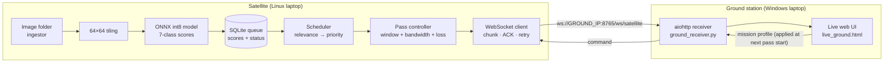

# 🛰️ Orbit Triage

**On-board AI triage for satellite imagery: the satellite decides what is worth the downlink.**

A satellite pass is short and the radio link is slow. Sending every image in capture order (FIFO) wastes that window on clouds, empty ocean and frames nobody asked for. Orbit Triage runs a tiny int8 vision model **on the satellite**, scores every image tile, and spends the pass on the tiles that match the current mission first.

> Hack_Orbital: the source code for our ML model, the prototype, and the satellite ↔ ground-station communication logic.

---

## Table of contents

1. [The idea in 30 seconds](#the-idea-in-30-seconds)
2. [System overview](#system-overview)
3. [The ML model](#the-ml-model)
4. [How triage decides](#how-triage-decides)
5. [Repository layout](#repository-layout)
6. [Quick start](#quick-start)
7. [Demo walkthrough](#demo-walkthrough)
8. [What we measured](#what-we-measured)
9. [Honest limits](#honest-limits)
10. [Tech stack](#tech-stack)
11. [Documentation](#documentation)
12. [Team](#team)

---

## The idea in 30 seconds

| Step | What happens |
|---|---|
| **1. Capture** | The satellite ingests an image and cuts it into 64×64 tiles. |
| **2. Infer** | A quantised MobileNetV3-Small scores each tile for 7 classes, on board. |
| **3. Store** | Every tile is kept with its raw scores. **Nothing is deleted.** |
| **4. Rank** | A mission profile turns scores into a *relevance* number and a priority. |
| **5. Downlink** | During a pass, the most relevant tiles go first over a throttled, lossy link. |
| **6. Re-plan** | After each pass the operator can pick a new mission. Tiles held on board are re-ranked and can go in the next pass. |

The ground station only ever shows what **actually arrived**.

---

## System overview



**Two-process design.** `satellite/` and `ground/` only talk over one WebSocket. The satellite never waits for the operator: if no new mission is chosen, the previous one simply continues.

---

## The ML model

| | |
|---|---|
| **Backbone** | MobileNetV3-Small (ImageNet-pretrained), single linear head |
| **Classes (7)** | Forest · Cropland · Urban · Water · Cloud · CloudShadow · Ship |
| **Output** | Independent sigmoid per class (multi-label) |
| **Input** | 64×64 RGB tile; resize to 96×96 and normalisation are **inside** the model |
| **Training** | Masked BCE, so each class is learned only from sources that really label it |
| **Compression** | Quantisation-aware training (FX graph mode) → int8 ONNX → packed graph |
| **Shipped file** | `model_qat_int8_packed.onnx`, **1.27 MB**, inside the 4.2 MB on-board budget |
| **Runtime** | ONNX Runtime (CPU, or CUDA if available) |

**Training data**

| Source | Used for |
|---|---|
| EuroSAT | Forest, Cropland, Urban, Water |
| CloudSEN12 (L1C) | Cloud, CloudShadow |
| HRSID (SAR) | Ship |

Everything is sliced to 64×64 tiles and split 70 / 15 / 15 (train / calibration / test). Each class is **evaluated only on the source where its labels are real**, so cloud scores are not flattered by cloud-free EuroSAT tiles.

---

## How triage decides

```
relevance = sum(scores of mission-interest classes)
            − Cloud score        (unless Cloud is in the interest list)
            − CloudShadow score  (unless CloudShadow is in the interest list)
```

| Relevance | Priority | Meaning |
|---|---|---|
| ≥ `picky + band` (default **0.90**) | 1 · MISSION | Send first |
| between the two | 2 · AMBIGUOUS | Send if there is room |
| ≤ `picky − band` (default **0.50**) | 3 · HELD | **Held on board**, never deleted |

Defaults: `picky = 0.70`, `band = 0.20`. When the operator changes the mission, every pending and held tile is re-ranked from its stored scores in a single database transaction. Tiles that were already ACKed are never re-sent.

Tile IDs sent to the ground are neutral (`IMG<hash>_000000`), so the true label is never leaked to the UI. Each card shows **capture time**, **latency** (computed on the satellite, so laptop clocks don't matter) and **priority**.

---

## Repository layout

The source is provided as two archives. Unzip them to browse the code.

```
Hack_Orbital/
├── README.md
├── PROJECT_DOCUMENTATION.md          ← full submission document
├── Orbit-Triage-Synced.zip           ← the working prototype (satellite ↔ ground)
│   └── Orbit-Triage-Synced/
│       ├── satellite/
│       │   ├── satellite_main.py     entry point
│       │   ├── scheduler.py          relevance, priority, re-rank
│       │   ├── feeder.py             drips dataset images in for live demos
│       │   ├── fifo_vs_triage.py     real-data FIFO vs triage comparison
│       │   ├── acquisition/          image ingestor
│       │   ├── inference/            ONNX engine + 64×64 tiling
│       │   ├── storage/              SQLite queue manager
│       │   ├── downlink/             pass controller + WebSocket client
│       │   └── model/model_qat_int8_packed.onnx
│       ├── ground/
│       │   ├── ground_receiver.py    aiohttp server + WebSocket bridge
│       │   └── live_ground.html      browser UI
│       └── SYNCED_README.md          engineering notes
└── Flow_code.zip                     ← how the model was built
    └── Flow_code/
        ├── phaseA_Collect and prepare the data/
        ├── Phase B_Shrink the model to int8/
        ├── Phase C_Train the model/
        └── Phase D_Final result/
```

`run_satellite.py` is an older single-image CLI and is **not** used in the network demo.

---

## Quick start

You need Python 3.10+. The demo is designed for two machines on one private network, but both parts also run on a single machine (use `127.0.0.1`).

### 1. Ground station

```bash
cd Orbit-Triage-Synced/ground
python -m pip install -r requirements.txt
python ground_receiver.py --host 0.0.0.0 --port 8765
```

Open **http://localhost:8765/**. The inbox starts empty. That is the proof the UI only shows what was received.

### 2. Satellite (first time)

```bash
cd Orbit-Triage-Synced/satellite
python3 -m venv venv
source venv/bin/activate          # Windows: venv\Scripts\activate
python -m pip install -r requirements.txt
```

### 3. Satellite (every run)

```bash
python3 satellite_main.py \
  --ground ws://<GROUND_IP>:8765/ws/satellite \
  --interest Forest Cropland Urban Water --cpu \
  --first-pass 10 --pass-period 120 --pass-length 60 --peak-kbps 256 \
  --stable-wait 0.1
```

> Use the ground machine's real IP (for a Windows hotspot this is usually `192.168.137.1`; check with `ipconfig`). On a two-machine run, never use `127.0.0.1` on the satellite side.

### 4. Feed images (separate terminal on the satellite)

```bash
python3 feeder.py --source-dir /path/to/dataset --interval 1.0
```

The feeder only copies from your dataset folder and never modifies it.

### Useful flags

| Flag | Default | Purpose |
|---|---|---|
| `--interest` | none | Mission classes: `Forest Cropland Urban Water Cloud Ship` |
| `--picky` / `--band` | `0.70` / `0.20` | Relevance threshold and ambiguity band |
| `--first-pass` | `10` s | Delay before the first pass |
| `--pass-period` / `--pass-length` | `120` / `60` s | Pass cadence and duration |
| `--peak-kbps` | `256` | Peak link rate during a pass |
| `--cpu` | off | Force CPU inference |

### Fresh start

Delete `storage/queue.db*`, `storage/tiles/*` and `storage/metadata/*.json` in `satellite/`. **Keep `storage/archive/`**; it is the source for recycling images into a new cycle.

### Reproducing the ML pipeline

`Flow_code/` holds the four phases in order (A data → B int8 → C training → D evaluation). Paths in these scripts point to the authors' machines (`data_root`, `DATA_ROOT`, `ROOT` via `.env`), so edit them for your setup. Per-script notes are in [PROJECT_DOCUMENTATION.md](PROJECT_DOCUMENTATION.md).

---

## Demo walkthrough

1. Show the **empty ground inbox** while the satellite queue grows (`python3 storage/queue_manager.py --list PENDING`).
2. **Mission A: Forest.** A pass opens automatically. Forest tiles go first and the rest stay held on board.
3. When the pass ends, a **60-second "Next mission?" popup** appears. Pick **Mission B: Vegetation** (Forest + Cropland).
4. At the **next pass start** the held Cropland tiles are re-ranked and sent, showing a larger latency because they waited since pass 1.
5. If the queue empties and a new mission is chosen, archived images are **recycled** and the ground inbox resets for a fresh run.
6. Compare with FIFO on real data:

```bash
python3 fifo_vs_triage.py --db storage/queue.db --pass-id PASS_0001 \
  --interest Forest --picky 0.70 --band 0.20
```

---

## What we measured

| Check | Result |
|---|---|
| Shipped int8 model size | **1.27 MB** (budget 4.2 MB) |
| Mission re-rank (Forest → Water) in unit test | Water tile → PENDING, Forest tile → HELD, ordering by priority → relevance → capture time |
| End-to-end test, real ONNX model, 6 images | 6 of 6 ACKed, no duplicates, no tile re-sent |
| Pass 1 (Forest) vs FIFO, same byte budget | Triage sent **3 relevant** tiles; FIFO sent **0** (gain **+3**) |
| Pass 2 (Vegetation) vs FIFO | Both sent 3 relevant (gain 0). Every remaining tile was relevant, so there was nothing to prioritise |

The FIFO advantage appears **when the queue has mixed relevance**. It is not claimed for every pass. These results come from a small 6-image run; per-class accuracy (AP / F1 from `Phase D_Final result/evaluate_test.py`) is in [PROJECT_DOCUMENTATION.md](PROJECT_DOCUMENTATION.md).

---

## Honest limits

- **Simulated link, sensor and passes.** The radio is a throttled WebSocket with a pass-shaped bandwidth curve and simulated packet loss; the "sensor" is dataset tiles; pass timing is emulated.
- **No flight hardware.** The model runs on a laptop with ONNX Runtime, not on an STM32 or flight computer. We claim the **model file size** (1.27 MB). We do not claim total on-board RAM.
- **Strict scoring for some missions.** Real-model Water tiles often carry high Cloud scores, so a *Water-only* mission can score negative relevance and stay held. Use the Vegetation preset, or add Cloud to the interest list. This is a calibration matter, not a UI bug.
- **Fault-injection buttons** exist in the UI, but the satellite replies "not implemented", so they do not affect the link.
- **No authentication.** Keep port 8765 on a trusted private network.
- **Two-laptop LAN run** (Windows ground + Linux satellite) has been tested on a single machine and with a local sender, so verify it on your own network before presenting.

---

## Tech stack

Python · PyTorch / torchvision · ONNX · ONNX Runtime · aiohttp · WebSockets · SQLite · NumPy · Pillow · vanilla HTML/CSS/JS (no front-end framework)

---

## Documentation

| File | What it covers |
|---|---|
| [`PROJECT_DOCUMENTATION.md`](PROJECT_DOCUMENTATION.md) | Full submission document: problem, architecture, ML pipeline, protocol, testing, limits, future work |
| `Orbit-Triage-Synced/SYNCED_README.md` | Engineering change log of the satellite ↔ ground sync |

---

## Team

<!-- Replace with your team details -->

| Name | Role |
|---|---|
| _Your name_ | _e.g. ML model & quantisation_ |
| _Teammate_ | _e.g. Satellite software_ |
| _Teammate_ | _e.g. Ground station & UI_ |

**Repository:** https://github.com/Yuvraj2412/Hack_Orbital

---

## License

_Add a license (for example MIT) before making the repository public._
